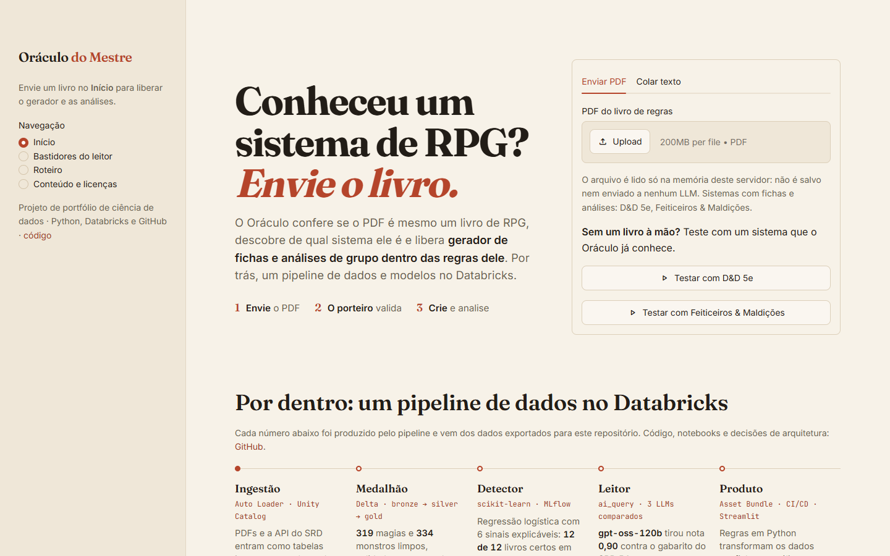
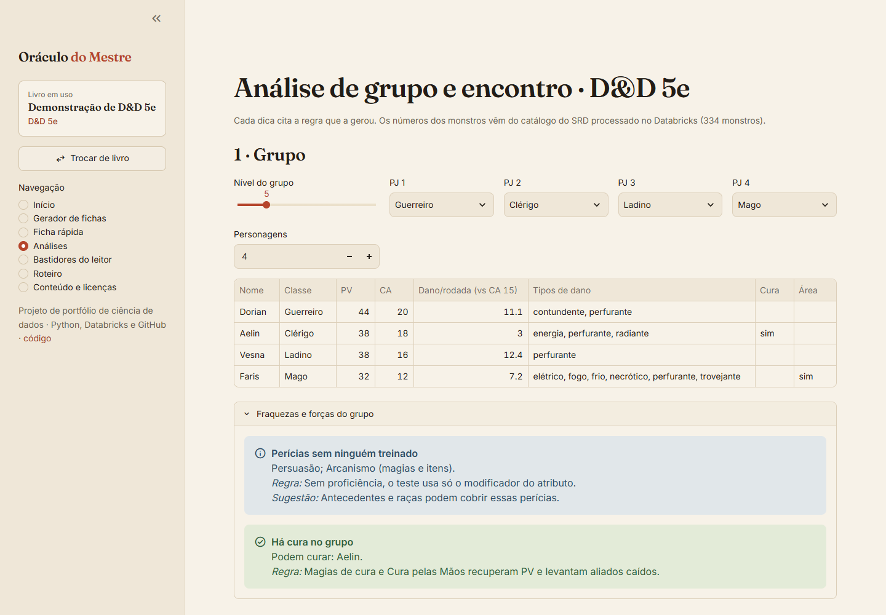
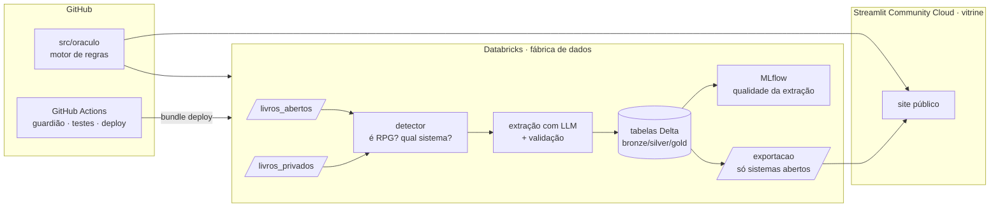
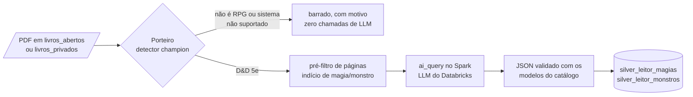
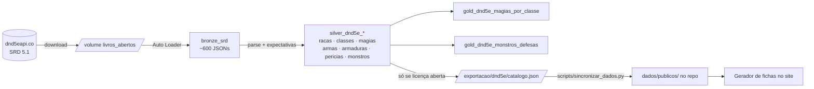

# Oráculo do Mestre

**Envie o livro de um sistema de RPG; o Oráculo confere se é mesmo RPG, descobre o sistema e
monta fichas e análises dentro das regras dele.** Projeto de portfólio de **ciência de dados e
engenharia de dados com Databricks**: pipeline medalhão, modelo de classificação avaliado sem
vazamento, avaliação de LLMs contra gabarito e MLOps de ponta a ponta, tudo gratuito.

[](https://github.com/Plee47/oraculo-do-mestre/actions/workflows/ci.yml)
[](https://oraculo-do-mestre.streamlit.app/)

**Site:** <https://oraculo-do-mestre.streamlit.app/> (se estiver "dormindo", clique em *Yes, get
this app back up!* e aguarde alguns segundos)



## O que este projeto demonstra

| Competência | Onde está a prova |
|---|---|
| **Engenharia de dados no Databricks** | Pipeline medalhão (bronze → silver → gold) em Delta, com Auto Loader, Unity Catalog e volumes; expectativas de qualidade que **derrubam o job** se o catálogo vier errado |
| **Machine learning com avaliação honesta** | Classificador "é livro de RPG?" com *feature engineering* explicável e validação **leave-one-book-out**, para não vazar estilo do mesmo livro entre treino e teste |
| **MLflow e registro de modelos** | Experimentos versionados, modelo no Unity Catalog com alias `champion` e **portão de qualidade** que só promove versões que acertam todos os livros |
| **Avaliação de LLMs** | Três LLMs do Databricks (`ai_query` em lote no Spark) medidos em precisão, recall e acerto por campo contra um **gabarito** oficial, com um run do MLflow por modelo |
| **Análise de dados aplicada** | Tabelas gold que viram regras: ex. 48% dos monstros de CR 11–16 resistem a dano físico não mágico, e isso muda o peso das dicas |
| **MLOps e engenharia de software** | Databricks Asset Bundles (dev/prod), GitHub Actions, 247 testes com pytest, pre-commit, ADRs e Conventional Commits |
| **Governança de dados** | Política de conteúdo automatizada: o "guardião" bloqueia no CI qualquer livro ou dado sem licença aberta; livros privados nunca saem do workspace |

## Resultados

| Peça | Número |
|---|---|
| Detector de livros (leave-one-book-out) | **F1 0,957** por página · **12 de 12** livros certos, incluindo romances de fantasia e um livro de xadrez |
| Leitor com LLM (gpt-oss-120b, escolhido entre 3) | nota **0,90** · **98% / 99%** dos campos de magias / monstros certos |
| Livro inteiro (SRD 5.1, 313 páginas) | **100%** das magias e **98,7%** dos monstros encontrados, zero erros de API |
| Catálogo processado | **319** magias · **334** monstros · 12 classes, idêntico no Databricks e localmente |
| Generalização | Livro real de *Feiticeiros & Maldições* (368 páginas) reconhecido com **nota 86%** sem retreinar o detector |

## Como funciona

1. **Envie o livro** (PDF ou trecho colado). O arquivo é lido só em memória.
2. **O porteiro valida:** o detector diz se é RPG e de qual sistema. Um romance não vira ficha;
   um RPG de sistema não suportado recebe o motivo.
3. **Crie e analise:** gerador de fichas, ficha rápida e análises de grupo e encontro, todos
   nas regras do sistema validado. Cada dica cita a regra que a gerou: **não há caixa-preta**.



**Sistemas:** D&D 5ª edição (SRD 5.1) · Feiticeiros & Maldições (v2.5)

## Arquitetura



Por que essa divisão: [ADR 0001](docs/decisoes/0001-databricks-fabrica-streamlit-vitrine.md).

## Detector de livros de RPG: ML com avaliação sem vazamento

Antes de gastar chamadas de LLM lendo um PDF, o Oráculo verifica: **isto é um livro de RPG?
De qual sistema?**

**Modelo:** regressão logística sobre 6 sinais que um mestre reconheceria, calculados por
página: notação de dados (`1d20`), modificadores (`+2`), siglas de atributos, vocabulário de
regras, blocos de estatísticas e texto que fala com o leitor. A nota do livro é a média das
páginas. O modelo é exportado como **JSON com 6 coeficientes** (sem pickle), então roda no
site em Python puro.

**Corpus:** 12 obras de licença aberta, com 2.326 páginas úteis (`oraculo/leitor/corpus.py`).

| Tipo | Obras |
|---|---|
| RPG | D&D SRD 5.1 e 5.2 (inglês), Tagmar — Regras e Magias (português) |
| Literatura | Dom Casmurro, Brás Cubas, Os Lusíadas |
| Fantasia (caso difícil) | The Well at the World's End, Phantastes, The Gods of Pegana, Alice |
| Regras de jogo (caso difícil) | Chess Fundamentals |

**Avaliação leave-one-book-out:** cada livro é previsto por um modelo que nunca viu nenhuma
página dele. Separar páginas do mesmo livro entre treino e teste vazaria estilo e vocabulário.

| Modelo | F1 por página | Livros certos | Nota do xadrez |
|---|---:|---:|---:|
| TF-IDF + regressão logística (referência) | 0,966 | 12/12 | 0,39 |
| 1ª versão das features (com "narrativa" e "densidade de números") | 0,924 | 11/12 | **0,78 ❌** |
| **Final: 6 features de evidência positiva** | **0,957** | **12/12** | **0,16** |

**O que deu errado no caminho (e por que isso importa):**

1. **Atalho "não é romance, então é RPG".** A 1ª versão usava sinais de narrativa e aprendeu
   que ausência de narrativa significa RPG. Resultado: o livro de xadrez virou RPG. A correção
   foi usar só sinais de *presença* de RPG.
2. **Palavras genéricas.** "player", "jogador", "teste", "nível" e "resistência" estavam no
   vocabulário. A métrica no corpus era ótima (F1 0,972), mas um teste com contraexemplos que
   escrevi mostrou que **um trecho de futebol em português recebia 1,00**. Sem nenhum texto de
   esporte em português no corpus, a métrica não tinha como enxergar isso. Troquei por termos
   específicos ("teste de resistência", "mestre do jogo"…): o F1 caiu um pouco (0,957), mas o
   futebol caiu para 0,04 e o xadrez em português para 0,04. Esses contraexemplos agora são
   testes automatizados.

O modelo treinado no Databricks e registrado no Unity Catalog (`detector_livro_rpg`, alias
`champion`) é idêntico ao treinado localmente (diferença de 10⁻¹³ nos coeficientes). O portão
de qualidade só promove versões que acertam **todos** os livros.

**Limitações:** PDFs escaneados (sem texto) não são lidos; o corpus tem só 4 livros de RPG
(2 sistemas). O sistema provável (D&D 5e, Tagmar, Feiticeiros & Maldições) vem de palavras
assinatura, não de um modelo treinado.

## Leitor de livros: LLMs avaliados contra gabarito



**Avaliação por gabarito:** o SRD 5.1 existe em PDF (entrada) e em dados estruturados
(catálogo da API), então dá para medir a extração campo a campo. As entradas esperadas em cada
página são achadas por regra, sem LLM. Três LLMs do Databricks rodaram sobre as mesmas 24
páginas sorteadas (49 magias, 27 monstros), com um run do MLflow para cada um:

| Modelo | Nota geral | Magias: precisão / recall | Monstros: precisão / recall | Campos certos (magias / monstros) | Tempo |
|---|---:|---:|---:|---:|---:|
| **gpt-oss-120b** (escolhido) | **0,90** | **0,93** / 0,84 | **0,90** / **1,00** | **98% / 99%** | 86 s |
| qwen3-next-80b | 0,73 | 0,59 / 0,84 | 0,70 / 0,96 | 95% / 98% | 38 s |
| llama-3.3-70b | 0,69 | 0,58 / 0,86 | 0,59 / 0,96 | 96% / 97% | 82 s |

Os três acertam quase todos os campos do que encontram. A diferença está na **precisão**: Llama e
Qwen também "extraem" magias só *citadas* no texto e entradas da página seguinte, contrariando a
instrução. Sem gabarito, isso passaria despercebido.

**Livro inteiro com o modelo escolhido** (313 páginas, zero erros de API):

| | Extraídos | Batem com o gabarito | Recall sobre as entradas do PDF |
|---|---:|---:|---:|
| Magias | 319 | 319 | **100%** (315/315) |
| Monstros | 326 | 306 | **98,7%** (306/310) |

Os 20 monstros "sem par" não são invenções: são blocos que existem no PDF mas não na API
(ex.: os *Animated Objects* da magia de mesmo nome e o *Avatar of Death*).

**Problemas reais que a avaliação revelou e que foram corrigidos:**

- **Texto sujo:** o PDF escreve "4th-level" com três hífens Unicode diferentes. Sem tratar
  isso, só 12 das 319 magias eram reconhecidas na página; depois, 315.
- **Uma palavra por linha:** algumas páginas saem do PDF assim ("Acid / Splash /
  Conjuration / cantrip"). A detecção das entradas passou a ignorar quebras de linha.
- **Condições como tipo de dano:** os LLMs punham "charmed" nas imunidades a dano. A saída
  agora é validada contra a lista de tipos de dano.

**Seus livros:** coloque um PDF no volume `livros_privados` (Catalog → workspace →
oraculo_dev → livros_privados → *Upload*) e rode o job. O porteiro decide, e o que for
extraído fica nas tabelas com `privado = true`, que **nunca são exportadas**
([ADR 0005](docs/decisoes/0005-leitor-de-livros-com-llm.md)).

## Pipeline medalhão no Databricks



| Camada | Tabela | O que garante |
|---|---|---|
| Bronze | `bronze_srd` | JSON exatamente como veio da API, ingestão incremental (Auto Loader) |
| Silver | `silver_dnd5e_*` | Uma tabela por entidade, colunas planas para SQL + `dados_json` completo |
| Gold | `gold_dnd5e_magias_por_classe` | Funções das magias (dano, controle, cura, utilidade) por classe e círculo |
| Gold | `gold_dnd5e_monstros_defesas` | Defesas dos monstros por faixa de CR (base numérica das dicas) |
| Exportação | `catalogo.json` | Só sai se o sistema estiver marcado como público (ADR 0002) |

O job **falha** se o catálogo não passar nas expectativas de qualidade: 12 classes com os 20
níveis completos, 300 ou mais magias, nenhuma magia apontando para uma classe inexistente…
O parsing usa as mesmas funções puras testadas no CI, e o catálogo gerado no Databricks é
idêntico ao gerado localmente.

### Gerador de fichas

Dado nível e papel (defensor, atacante, conjurador ou suporte), o gerador monta a ficha e
explica cada escolha:

1. **Classe** do papel pedido.
2. **Atributos** pelo conjunto padrão, na ordem de prioridade da classe.
3. **Raça** cujos bônus mais combinam com essa prioridade.
4. **Melhorias de atributo** de acordo com a tabela de níveis do SRD.
5. **Perícias** ligadas aos atributos mais altos.
6. **Armadura** de maior CA permitida (respeitando FOR mínima e "druida não usa metal").
7. **Arma** coerente com o estilo (acuidade com DES, sem arma de duas mãos com escudo).
8. **Magias** pela função do papel, evitando acumular magias de concentração.

**Limitações conhecidas:** o equipamento ignora o custo em ouro (um guerreiro de nível 1 pode
sair de armadura completa), não há subclasses nem talentos, e os nomes de magias e itens ficam
em inglês, como no SRD.

## Análises e dicas explicáveis

Monte o grupo, escolha os monstros, e o Oráculo aponta o que está desequilibrado. **Cada dica
diz qual regra a gerou**, então não há caixa-preta.

| Análise | Exemplo real (grupo de nível 5: guerreiro, clérigo, ladino, mago) |
|---|---|
| Papéis e cura | Grupo só de combatentes: "Ninguém do grupo cura" |
| Testes de resistência | "Resistência de SAB fraca (média +1.2), ninguém proficiente" |
| Tipos de dano | "Todo o dano do grupo é físico e não mágico" |
| Defesas dos monstros | "Gargoyle reduz à metade o dano do guerreiro e do ladino" |
| Vulnerabilidades | "O guerreiro (martelo) causa dano dobrado em Skeleton" |
| Efeitos que exploram fraquezas | "Frightful Presence (Adult Red Dragon): o grupo falha 74% das vezes" |
| Risco de queda | "Adult Red Dragon pode derrubar todo o grupo num único turno (sopro, 63 de dano)" |
| Economia de ações | "Ogre sozinho age 1 vez para cada 4 do grupo" |
| Balanço | Rodadas para vencer × rodadas até o grupo cair, por dano esperado |

**O que os dados mostram** (`gold_dnd5e_monstros_defesas`, calculada no Databricks):

| Faixa de CR | Monstros | Resistem a físico não mágico | Voam | Ações lendárias |
|---|---:|---:|---:|---:|
| 0 a 1/2 | 113 | 2% | 22% | 0% |
| 1 a 4 | 105 | 23% | 24% | 0% |
| 5 a 10 | 67 | 34% | 30% | 3% |
| 11 a 16 | 29 | 48% | 62% | 45% |
| 17+ | 20 | 35% | 80% | 85% |

Por isso a dica "todo o dano é físico" pesa mais conforme o grupo sobe de nível, e "ninguém
ataca à distância" vira alerta contra monstros de CR alto.

**Limitações:** as estimativas usam dano médio esperado, sem posicionamento, terreno ou
magias de controle; magias de monstros conjuradores (ex.: lich) não entram no dano por turno.

## Segundo sistema: Feiticeiros & Maldições

Segundo sistema, para provar que o motor é genérico: adicionar um sistema é uma pasta nova
em `src/oraculo/sistemas/` com um `sistema.yaml` (dados) e as regras em Python (fórmulas).

| Peça | O que faz |
|---|---|
| `sistemas/fm/sistema.yaml` | 6 especializações, 7 origens, perícias, testes de resistência, compra de pontos |
| `sistemas/fm/__init__.py` | PV, PE/estamina, Defesa, CD de especialização e de técnica, resistências (mestre no nível 9) |
| `sistemas/fm/gerador.py` | Fichas válidas com cada escolha explicada (origem, atributos, perícias, equipamento) |
| `sistemas/fm/analise.py` | Fraquezas do grupo: falta de Suporte, linha de frente, resistências sem treino, alcance |

As fórmulas são testadas contra o exemplo de criação passo a passo do próprio livro
(Especialista em Combate com CON 16 → 15 PV e 4 PE no nível 1).

**O porteiro reconhece o livro:** o PDF real (368 páginas) passa como "livro de Feiticeiros
& Maldições (nota 86%)", sem retreinar o detector. Ele é aceito no leitor, mas não vai ao
extrator de magias e monstros: o livro base não tem listas prontas (cada jogador cria a
própria técnica e os feitiços) nem bestiário, então **ainda não há análise de encontro**
para este sistema.

**Licença:** projeto de fãs gratuito que permite usar o sistema como base, com crédito aos
autores. Aqui ficam só as fórmulas, resumidas à mão; nada do texto do livro entra no
repositório, e `conteudo_publico: false` faz o guardião bloquear qualquer dado extraído dele
([ADR 0006](docs/decisoes/0006-feiticeiros-e-maldicoes.md)).

## Design do site

A parte visual foi construída com três guias de design (*skills*) de referência, aplicados
sobre o tema do Streamlit (`.streamlit/config.toml`) e uma camada de CSS (`app/estilo.css`):

| Guia | O que trouxe |
|---|---|
| [**Impeccable**](https://github.com/pbakaus/impeccable) (Paul Bakaus) | Direção por "modo" da tela: o início é vitrine, as ferramentas são de operação, com precisão e contenção. Também o piso de qualidade: contraste, seleção de texto, foco, barra de rolagem e números tabulares tematizados, e nada de emoji no lugar de ícones |
| [**Taste Skill**](https://github.com/leonxlnx/taste-skill) | Um único sistema visual (uma paleta, um estilo de botão e de borda), texto direto que diz o que o produto faz, o produto real na tela e nada de violeta genérico |
| [**Design Engineering de Emil Kowalski**](https://github.com/emilkowalski/skills) | Micro-interações: botões que afundam ao clique (`scale(0.97)`), curvas de animação próprias abaixo de 300 ms, hover só em dispositivos com mouse e respeito a movimento reduzido |

O resultado é a identidade **"grimório de dados"**: papel quente, tinta escura e um único
destaque cor de brasa. Os títulos usam Fraunces (serifa que lembra livro de regras), o texto
usa Inter e os dados usam JetBrains Mono. O pipeline do Databricks aparece no início como uma
linha do tempo, não como uma grade de cards.

## Roteiro

- [x] **Fase 0 · Fundação:** ficha genérica, D&D 5e, site no ar, CI/CD e guardião de conteúdo
- [x] **Fase 1 · D&D SRD:** pipeline medalhão no Databricks com o SRD e gerador de fichas
- [x] **Fase 2 · Análises:** fraquezas do grupo, desequilíbrio de encontros, dicas explicáveis
- [x] **Fase 3a · Detector de livros:** "é livro de RPG?" com modelo explicável avaliado no MLflow
- [x] **Fase 3b · Leitor de livros:** porteiro + extração com LLM (modelos do Databricks) avaliada contra o SRD
- [x] **Fase 4 · Feiticeiros & Maldições:** segundo sistema (fichas, análise de grupo, porteiro)
- [x] **Fase 5a · Vitrine:** site que começa pelo livro, design e README de portfólio
- [ ] **Fase 5b · Demonstração:** vídeo curto do fluxo completo

## Estrutura

```
├── src/oraculo/
│   ├── nucleo/             # ficha genérica, achados de análise, contrato de sistema
│   ├── sistemas/dnd5e/     # regras, catálogo, parser do SRD, gerador, análises
│   ├── sistemas/fm/        # Feiticeiros & Maldições: regras, gerador, análise de grupo
│   ├── leitor/             # corpus, detector, porteiro, extração com LLM, avaliação
│   └── guardiao.py         # bloqueia livros/dados protegidos no repo (ADR 0002)
├── dados/publicos/         # dados exportados pelo Databricks (só licença aberta)
├── scripts/
│   ├── deploy.py           # deploy no Databricks: código no volume + bundle (ADR 0004)
│   ├── carregar_srd.py     # plano B: baixa o SRD localmente e envia ao volume
│   └── sincronizar_dados.py# traz o catálogo exportado para dados/publicos/
├── app/                    # site Streamlit (estilo.css: camada visual)
├── .streamlit/            # tema do site
├── pipelines/              # notebooks e jobs do Databricks
├── databricks.yml          # Asset Bundle (targets dev/prod)
├── docs/decisoes/          # registros de decisões de arquitetura (ADRs)
└── tests/                  # pytest (inclui smoke test do site)
```

## Rodando

```bash
python -m venv .venv && source .venv/bin/activate   # Windows: .venv\Scripts\activate
pip install -e ".[dev]"
pytest                                   # testes
streamlit run app/streamlit_app.py       # site local em http://localhost:8501
```

**Databricks** (funciona no [Free Edition](https://www.databricks.com/learn/free-edition)):

```bash
databricks auth login --host https://<seu-workspace>.cloud.databricks.com
python scripts/deploy.py --run      # envia o código ao volume, faz o deploy e roda o pipeline
python scripts/sincronizar_dados.py # traz o catálogo exportado para dados/publicos/
```

O código vai para um volume do Unity Catalog em vez da pasta do workspace. O motivo está no
[ADR 0004](docs/decisoes/0004-codigo-em-volume.md).

**Site público:** em [share.streamlit.io](https://share.streamlit.io), faça login com o GitHub
e escolha este repositório e o arquivo `app/streamlit_app.py`.

## Como trabalhamos

- `main` protegida; mudanças entram por PR com [template](.github/pull_request_template.md) e CI
  verde.
- [Conventional Commits](https://www.conventionalcommits.org/pt-br/) (`feat:`, `fix:`, `docs:`…).
- `pre-commit install` liga ruff e guardião antes de cada commit.
- Decisões importantes viram um ADR em [`docs/decisoes/`](docs/decisoes/).

## Conteúdo e licenças

Este repositório e o site publicam **apenas conteúdo de licença aberta**
([ADR 0002](docs/decisoes/0002-politica-de-conteudo.md)). Livros protegidos podem ser
processados no seu próprio ambiente, mas o resultado nunca é versionado.

Este trabalho inclui material do *System Reference Document 5.1* da Wizards of the Coast LLC,
disponível em <https://dnd.wizards.com/resources/systems-reference-document> e licenciado sob
[CC BY 4.0](https://creativecommons.org/licenses/by/4.0/legalcode).

O detector de livros foi treinado também com o *Tagmar* (Projeto Tagmar, licença
[CC BY-NC-SA 3.0 BR](https://creativecommons.org/licenses/by-nc-sa/3.0/br/)), com o *SRD 5.2*
(CC BY 4.0) e com obras em domínio público do [Projeto Gutenberg](https://www.gutenberg.org).
Nenhum desses textos é publicado aqui: só os 6 coeficientes do modelo.

As mecânicas de *Feiticeiros & Maldições* (Livro de Regras v2.5) são de Setsugiri, Parker e
equipe, num projeto de fãs gratuito inspirado em *Jujutsu Kaisen*, de Gege Akutami. O livro
permite usar o sistema como base desde que os autores recebam crédito. Este repositório tem
apenas um resumo das fórmulas, escrito para o projeto, sem texto do livro.
