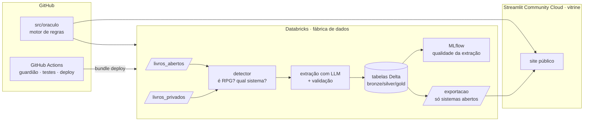

# 🔮 Oráculo do Mestre

**Lê livros de RPG, monta fichas válidas e aponta o que está desequilibrado na sua mesa.**
Projeto de portfólio de ciência de dados com **Python + Databricks + GitHub**, 100% gratuito.

> 🌐 **Demo online:** _link do Streamlit aqui depois do primeiro deploy_

## O que faz

| Função | Exemplo |
|---|---|
| **Detector de livros** | "Este PDF é um livro de RPG (97%), sistema D&D 5e, tipo bestiário" |
| **Leitor de livros** | Extrai classes, magias, técnicas e criaturas para tabelas estruturadas |
| **Gerador de fichas** | Personagens e NPCs válidos pelas regras, com as escolhas explicadas |
| **Análise do grupo** | "Ninguém do grupo é bom em resistência de Sabedoria e o chefe usa Medo" |
| **Análise de encontro** | "3 dos 4 inimigos são imunes a veneno, e o dano do seu ladino depende disso" |

As dicas vêm de um **motor de regras explicável**: cada dica diz qual mecânica do sistema a
gerou. O LLM só é usado para ler os livros e para escrever as dicas em linguagem natural.

**Sistemas:** D&D 5ª edição (SRD 5.1) · Feiticeiros & Maldições (Fase 4)

## Arquitetura



Por que essa divisão: [ADR 0001](docs/decisoes/0001-databricks-fabrica-streamlit-vitrine.md).

## Roteiro

- [x] **Fase 0 · Fundação:** ficha genérica, D&D 5e, site no ar, CI/CD e guardião de conteúdo
- [ ] **Fase 1 · D&D SRD:** pipeline medalhão no Databricks com o SRD e gerador de fichas
- [ ] **Fase 2 · Análises:** fraquezas do grupo, desequilíbrio de encontros, dicas explicáveis
- [ ] **Fase 3 · Leitor de livros:** detector "é livro de RPG?" e extração com LLM avaliada contra o SRD
- [ ] **Fase 4 · Feiticeiros & Maldições:** segundo sistema, extraído pelo leitor
- [ ] **Fase 5 · Polimento:** resultados, vídeo de demonstração

## Estrutura

```
├── src/oraculo/
│   ├── nucleo/             # ficha genérica + contrato de sistema (ADR 0003)
│   ├── sistemas/dnd5e/     # sistema.yaml (dados SRD) + regras em Python
│   └── guardiao.py         # bloqueia livros/dados protegidos no repo (ADR 0002)
├── app/                    # site Streamlit
├── pipelines/              # notebooks e jobs do Databricks
├── databricks.yml          # Asset Bundle (targets dev/prod)
├── docs/decisoes/          # registros de decisões de arquitetura (ADRs)
└── tests/                  # pytest (inclui smoke test do site)
```

## Rodando

```bash
python -m venv .venv && source .venv/bin/activate   # Windows: .venv\Scripts\activate
pip install -e ".[dev]"
pytest                                   # testes
streamlit run app/streamlit_app.py       # site local em http://localhost:8501
```

**Databricks** (funciona no [Free Edition](https://www.databricks.com/learn/free-edition)):

```bash
databricks auth login --host https://<seu-workspace>.cloud.databricks.com
databricks bundle deploy && databricks bundle run oraculo_pipeline
```

**Site público:** em [share.streamlit.io](https://share.streamlit.io), faça login com o GitHub
e escolha este repositório e o arquivo `app/streamlit_app.py`.

## Como trabalhamos

- `main` protegida; mudanças entram por PR com [template](.github/pull_request_template.md) e CI
  verde.
- [Conventional Commits](https://www.conventionalcommits.org/pt-br/) (`feat:`, `fix:`, `docs:`…).
- `pre-commit install` liga ruff e guardião antes de cada commit.
- Decisões importantes viram um ADR em [`docs/decisoes/`](docs/decisoes/).

## Conteúdo e licenças

Este repositório e o site publicam **apenas conteúdo de licença aberta**
([ADR 0002](docs/decisoes/0002-politica-de-conteudo.md)). Livros protegidos podem ser
processados no seu próprio ambiente, mas o resultado nunca é versionado.

Este trabalho inclui material do *System Reference Document 5.1* da Wizards of the Coast LLC,
disponível em <https://dnd.wizards.com/resources/systems-reference-document> e licenciado sob
[CC BY 4.0](https://creativecommons.org/licenses/by/4.0/legalcode).
